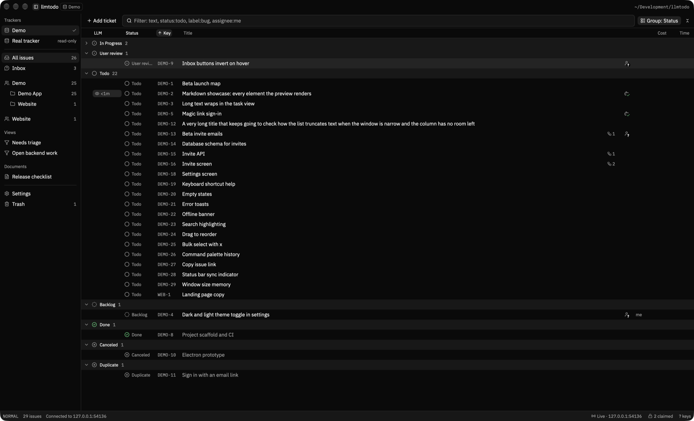

# llmtodo

A local, Linear-style task tracker built for LLM agents. Agents work through a CLI that covers every feature. People watch and steer from a fast native macOS app. Both talk to one local API server that stores everything in a SQLite file.



## Features

- Teams, projects, milestones, issues and sub-issues with keys such as `ABC-12`
- Statuses, priorities, labels with groups, assignees and saved views
- Markdown descriptions with collapsible `+++` sections for agent notes
- Atomic claims, so two agents never take the same ticket
- A frontier query that lists the open, unblocked work under a map issue
- Relations, dependency trees, attachments, comments and full history
- Agent questions to the owner, answered from the app's inbox
- A review flow: agents hand UI work to the owner, who approves or asks for changes
- Work sessions with time and token cost per ticket
- Full-text and duplicate search, GitHub sync, daily backups and a Linear import
- JSON output, `--no-input` and stable exit codes for every CLI command

## Install

You need macOS and a Rust toolchain.

```sh
git clone https://github.com/xavortm/llmtodo && cd llmtodo
cargo install --locked --path crates/cli   # the llmtodo CLI, which also holds the server
scripts/publish                            # optional: the desktop app in ~/Applications
```

### The server

The CLI and the app need the local server on `127.0.0.1:7878`. Both start it on their first call when it is not running, so you usually do nothing. To keep it running from login, use launchd:

```sh
llmtodo server install    # start at login
llmtodo server status     # check that it runs
```

Data lives in `~/Library/Application Support/llmtodo`. Set `LLMTODO_DATA_DIR` to use another folder.

### Set up a repo for agents

Run this at the root of each repo whose agents should use llmtodo:

```sh
llmtodo init --team ABC --project my-app --create --no-input
```

This command writes `.llmtodo.toml` and installs the agent skill in `~/.claude/skills/llmtodo`. Agents read the skill before their first tracker command. The full command list is in [docs/agents/cli-reference.md](docs/agents/cli-reference.md).

## More

- [SPEC.md](SPEC.md): scope, stack and decisions
- [ARCHITECTURE.md](ARCHITECTURE.md): which crate may depend on which
